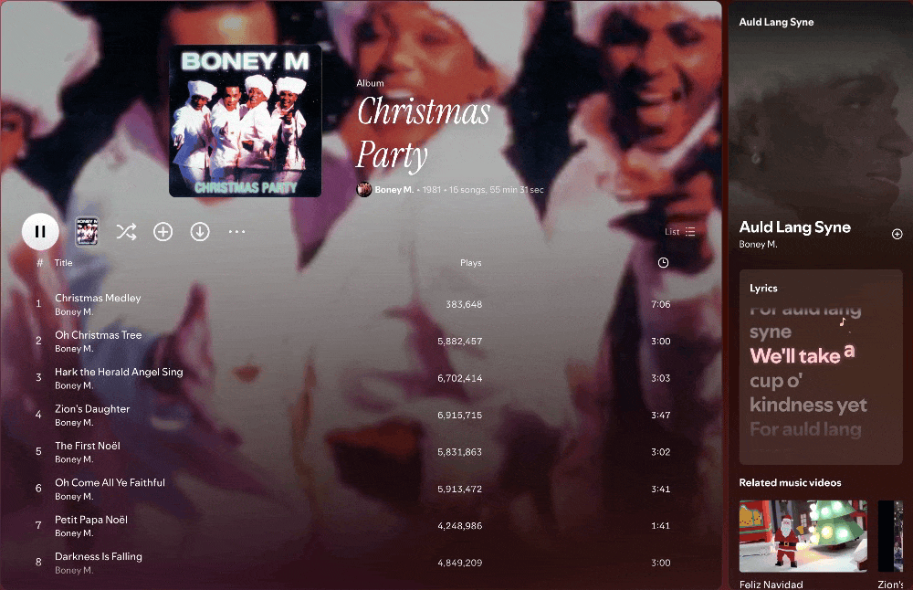
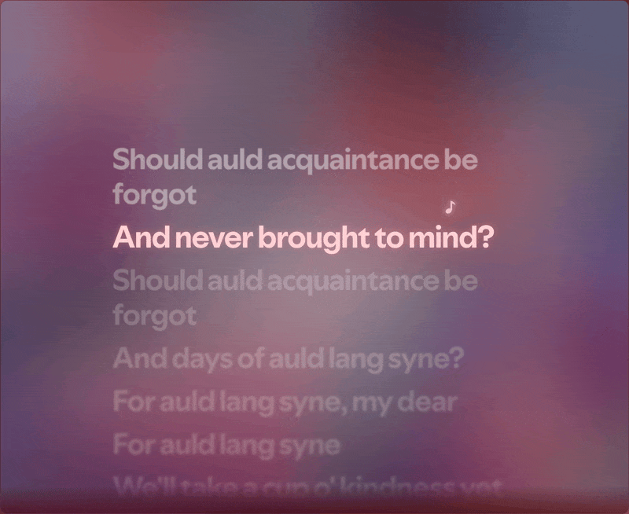
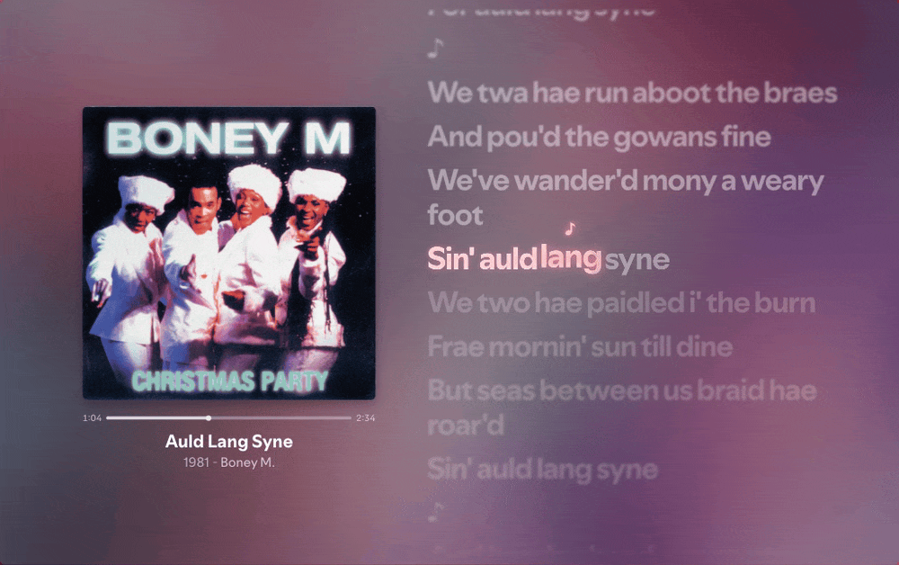
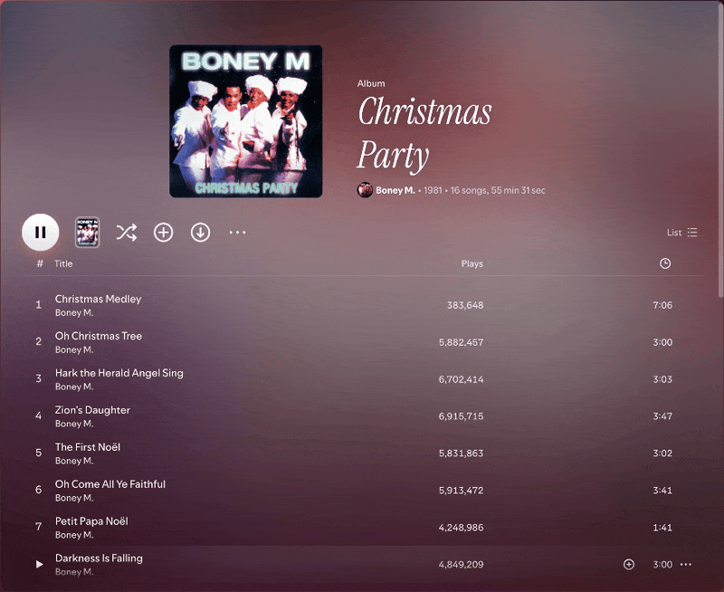
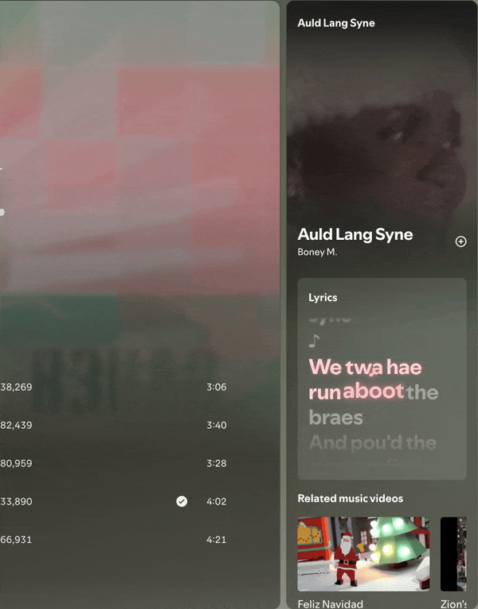
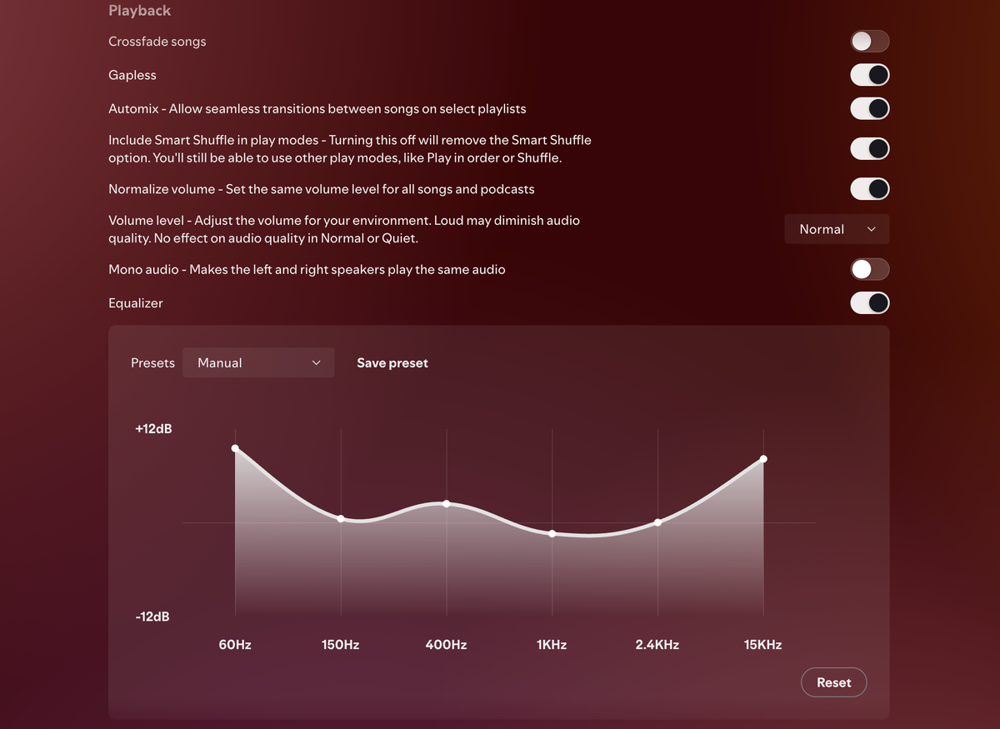
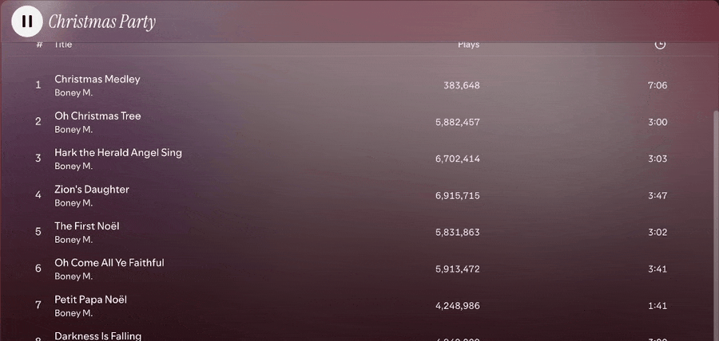
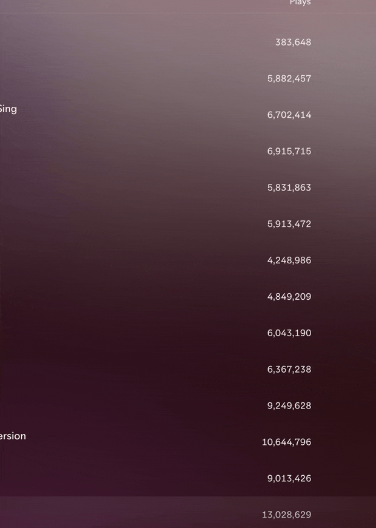

# Glass

Frosted glass for Spotify 1.3. The whole app floats over your music's colours, every menu and button is glass, and synced lyrics come built in, with words that light up, jump and sparkle as they're sung.

<p align="center">
  
</p>

## Highlights

- **Your music's colours everywhere**: an animated gradient follows the song that's playing, or the playlist, album or artist you're viewing
- **Beautiful Lyrics built in**: word-by-word glow, a note that hops across the line, sparkles, and lines that glide into place
- **Glass on every surface**: panels, menus, submenus, tooltips, dialogs, buttons and switches share one frosted look
- **Headers that move**: album covers blur and drift, artist and playlist headers cycle through their covers
- **Fast**: built and measured on Spotify 1.3 so the effects don't cost smoothness

## Lyrics that move with the song

Press the Lyrics button and Spotify's lyrics view is replaced by [Beautiful Lyrics](https://github.com/surfbryce/beautiful-lyrics), restyled and extended for Glass.

<p align="center">
  
</p>

- **Word by word**: the line being sung fills in word by word, and each word does a little jump as it starts
- **A note that hops**: a ♪ bounces from word to word in time with the song, leaving a few sparkles behind
- **Glides, not jumps**: when a new line starts, the lyrics ease into place with the lines below trailing slightly, like a ripple
- **The song's colour**: the glow takes its colour from the cover, or from a colour you pick in Theme settings
- **In the sidebar too**: the Now Playing panel shows the same lyrics in a glass card, and Spotify's own lyrics card is hidden

Spotify only provides timing for whole lines, so Glass estimates when each word is sung from its length.

### Full screen

The full screen button opens a full screen view with the cover, playback controls and large lyrics. Hover the cover and its glass controls fade in.

<p align="center">
  
</p>

## Glass everywhere

Menus, submenus, tooltips and the play button all share the frosted look. Hover a menu row and it gets a soft rounded highlight instead of a grey block. The play button is a white pearl that glows in the playing song's colour and lifts when you hover it. Scroll down and the header stays pinned as a sticky glass bar.

<p align="center">
  
</p>

<p align="center">
  
  
</p>

- **Smooth panel switching**: switching between Now Playing and Listening activity shows one panel at a time, with no overlapping text, and the new panel fades in. Closing Now Playing leaves a slim glass tab instead of a squashed sliver
- **Switches you can read**: a light track with a dark knob when on, translucent when off
- **No Spotify green**: the equalizer curve and Glass's own switches are white to match the theme
- **Glass dialogs**: the Add to playlist and Theme settings dialogs are frosted too

## Headers that move

Artist and playlist headers cycle through their covers, each one building in from tiles. Album headers become a fully blurred copy of the cover that slowly drifts and turns.

<p align="center">
  
</p>

Hover any header and press **Aa** to give that playlist, album or artist its own title font. Titles are tinted to match the cover.

## Make it yours

The sliders button in the top bar opens **Theme settings**:

<p align="center">
  
</p>

- **Background**: the animated gradient, or your own image from a URL or a file
- **Lyrics colour**: match the song, or pick any colour
- **Options**: use the playing song's cover as the background, use the Home background on every page, and blur custom images

Glass also draws its own Connect device icons for Echo, HomePod, Nest, Sonos, iPhone, MacBook, TVs, consoles and more.

## Fast

The effects are tuned so the app stays smooth:

- The lyrics background renders at half resolution and 30 fps. It's heavily blurred, so it looks identical, at a fraction of the GPU cost
- The hopping note, sparkles, word jumps and line glides run on the compositor, and the sparkles are reused instead of created for every word
- Glass avoids CSS selectors that slow down every style update, so panel switches do about half the work they used to
- The lyrics page holds 60 fps while the song plays

## Install

### Marketplace

Open Marketplace in Spotify, go to **Themes** and install **Glass**. Lyrics are included.

### Manual

Clone this repo into your Spicetify `Themes` folder as `Glass`, then:

```sh
spicetify config current_theme Glass color_scheme base
spicetify config inject_css 1 replace_colors 1 overwrite_assets 1 inject_theme_js 1
spicetify apply
```

For the lyrics, copy `beautiful-lyrics.mjs` into your Spicetify `Extensions` folder and run:

```sh
spicetify config extensions beautiful-lyrics.mjs
spicetify apply
```

The Spicetify folder is `~/.config/spicetify` on macOS and Linux, and `%appdata%\spicetify` on Windows.

If you also installed the separate Beautiful Lyrics extension from Marketplace, remove it: its servers are offline, and Glass includes a maintained copy.

## Development

`pnpm dev` serves `theme.js` and `user.css` with hot reload; load `dev-loader.js` as a Spicetify extension to use them.

## Credits

Started from [Galaxy](https://github.com/harbassan/spicetify-galaxy) by harbassan.

Lyrics come from [Beautiful Lyrics](https://github.com/surfbryce/beautiful-lyrics) by surfbryce, included with the author's permission. The bundled copy carries fixes from pull requests by Chere3, Spikerko and npt-1707, loads lyrics from Spotify instead of the retired Beautiful Lyrics servers, and adds the word effects above.

The demo recordings use Boney M.'s "Auld Lang Syne"; its lyrics are Robert Burns' 1788 poem, which is in the public domain.
