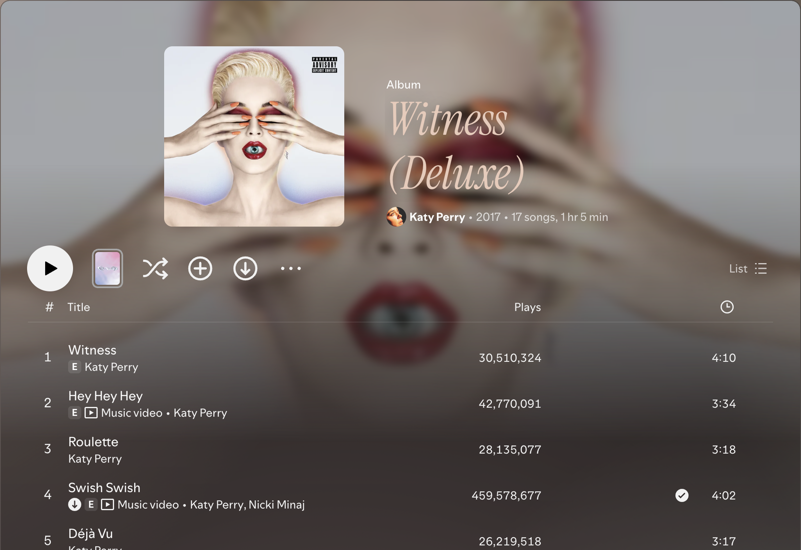

# Glass

A Spicetify theme for Spotify 1.3 that turns the app into frosted glass over your music's colours.



## Features

- **Animated gradient background** in the colours of the song that's playing, or of the playlist, album or artist you're viewing
- **Cover reel** on playlist and artist headers: the covers of the page's tracks take turns, each one building in from tiles
- **Glass panels** with one tint, border and radius, and a progressive blur under sticky headers
- **Title fonts per page**: hover a header and press **Aa** to pick a font for that playlist, album or artist; titles are tinted to the cover
- **Connect device icons** drawn for Echo, HomePod, Nest, Sonos, iPhone, MacBook, TVs, consoles and more
- **Theme settings** (sliders button in the top bar): switch between the gradient and your own background image, and blur options

## Install

### Marketplace

Open Marketplace in Spotify, go to **Themes** and install **Glass**.

### Manual

Clone this repo into your Spicetify `Themes` folder as `Glass`, then:

```sh
spicetify config current_theme Glass color_scheme base
spicetify config inject_css 1 replace_colors 1 overwrite_assets 1 inject_theme_js 1
spicetify apply
```

The Spicetify folder is `~/.config/spicetify` on macOS and Linux, and `%appdata%\spicetify` on Windows.

## Development

`pnpm dev` serves `theme.js` and `user.css` with hot reload; load `dev-loader.js` as a Spicetify extension to use them.

## Credits

Started from [Galaxy](https://github.com/harbassan/spicetify-galaxy) by harbassan.
